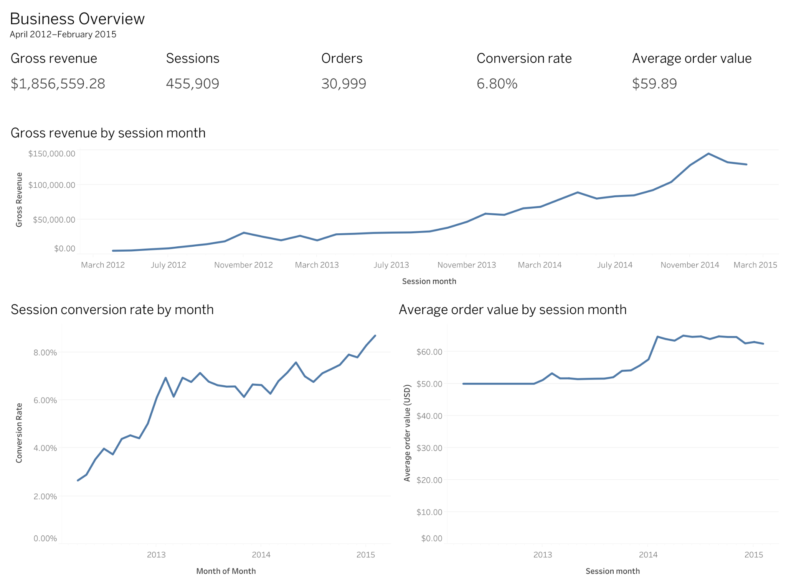
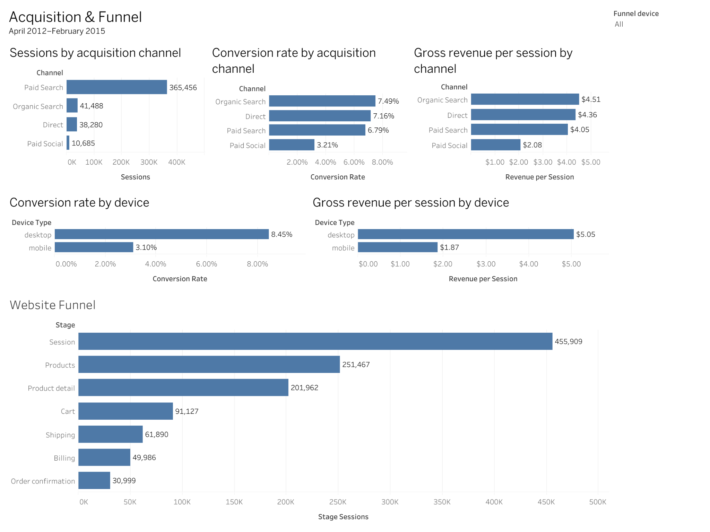
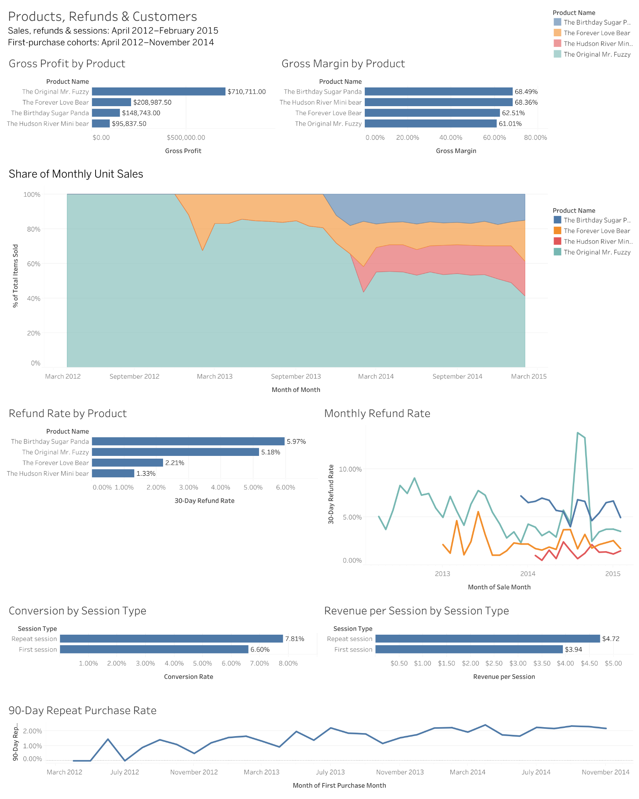

# Maven Fuzzy Factory: E-commerce Performance Analysis

**PostgreSQL · Tableau · E-commerce analytics**

An analysis of growth, acquisition, website conversion, product economics, refunds, and repeat purchasing for Maven Fuzzy Factory, an online teddy-bear retailer. The project uses SQL to prepare seven aggregate datasets and Tableau to communicate the results across three dashboards.

**Business question:** Where should the business focus its next conversion, merchandising, and customer-experience investigations as it grows?

**Reporting period:** April 2012–February 2015, with first-purchase cohorts through November 2014 to allow a full 90-day repeat-purchase window. The overview export also retains the two partial boundary months for reference; they are excluded from the headline results below.

**Project status:** Analysis and dashboard reviews are complete. This repository includes the recovered export SQL, aggregate outputs, source attribution, documentation, and runnable export checks. The revised packaged Tableau workbook is included, with the overview source connection and default filters confirmed in its saved settings. Full-size dashboard images are included below. The public dashboard link and exact executed SQL environment remain to be finalized. See the [release checklist](docs/release_checklist.md).

## Business snapshot

| Metric | Complete-month result |
|---|---:|
| Sessions | 455,909 |
| Orders / converting sessions | 30,999 / 30,999 |
| Gross revenue | $1,856,559.28 |
| Session conversion | 6.80% |
| Average order value | $59.89 |
| Items sold | 38,272 |
| Pre-refund gross profit | $1,164,279.00 |

Revenue is before refunds. Session-based figures attribute orders to the linked session's start month. Item totals and gross profit use item sale dates. Those dates produce some monthly differences even though the complete-period revenue totals agree. Definitions are in the [metric dictionary](docs/metric_dictionary.md).

## Main findings

1. **Growth reflects traffic and purchase efficiency.** From 2013 to 2014, gross revenue grew 173.52%, sessions grew 106.97%, conversion rose from 6.60% to 7.22%, and average order value increased from $52.81 to $63.80.
2. **Paid Search supplies scale; Organic Search shows higher observed efficiency.** Paid Search generated 365,456 sessions. Organic Search converted at 7.49% and generated $4.51 per session. Acquisition costs are unavailable, so this does not establish channel profitability.
3. **Mobile conversion warrants investigation.** Mobile converted at 3.10%, compared with 8.45% on desktop. These descriptive differences do not establish a device or UX cause.
4. **Different funnel losses imply different investigations.** Product detail → cart had the largest conditional loss, 54.88%. Entry → products lost the most sessions in absolute terms, 204,442.
5. **The product mix diversified while the flagship grew.** Mr. Fuzzy increased from 818 units in December 2013 to 1,584 in December 2014, while its share fell from 71.75% to 51.13%.
6. **Refund patterns differ by product and time.** Sugar Panda's complete-period 30-day item-refund rate was 5.97%, versus Mini Bear's 1.33%. Mr. Fuzzy had a temporary August–September 2014 spike that subsequently subsided.
7. **Return visits and repeat purchases are distinct behaviors.** Repeat sessions converted at 7.81%, versus 6.60% for first sessions. Separately, 439 of 24,105 customers in the eligible first-purchase cohorts placed another order within 90 days, a weighted 1.82%.

See [findings and evidence](docs/findings.md) and [prioritized recommendations](docs/recommendations.md) for the supporting counts, implications, and limitations. Recommendations are proposed tests and investigations; no resulting business lift is claimed.

## Tableau dashboards

| Dashboard | Purpose |
|---|---|
| Business Overview | Track revenue, traffic, conversion, and order value. |
| Acquisition & Funnel | Compare channels and devices; inspect the ordered conversion path. |
| Products, Refunds & Customers | Compare product economics and mix, 30-day refunds, session types, and 90-day purchase cohorts. |

[Download the revised packaged workbook](tableau/ecommerce.twbx) received October 18, 2026. It contains all three dashboards and seven embedded extracts. The overview connects to `monthly_overview.csv`, keeps April 2012–February 2015 selected, and the funnel defaults to all devices. Full-size exports received October 20 show the complete layouts and match the reviewed headline values. Static images and saved-package checks do not independently verify live interactions or embedded extract rows. A Tableau Public link remains pending. See [workbook review and handoff](tableau/README.md).

### Business Overview

April 2012–February 2015. The five headline metrics reconcile to the complete-month reporting window.



[Open full-size Business Overview](tableau/business_overview.png).

### Acquisition & Funnel

The funnel is shown for all devices. Paid Search provides most traffic; desktop has the higher observed conversion rate. These comparisons do not establish channel profitability or a causal device effect.



[Open full-size Acquisition & Funnel](tableau/acquisition_funnel.png).

### Products, Refunds & Customers

Sales, refunds and sessions cover April 2012–February 2015. First-purchase cohorts cover April 2012–November 2014 to allow 90 days of follow-up. Gross profit and margin are before refunds.



[Open full-size Products, Refunds & Customers](tableau/products_refunds_customers.png). Product color key for the mix and refund charts: blue — The Birthday Sugar Panda; orange — The Forever Love Bear; red — The Hudson River Mini bear; teal — The Original Mr. Fuzzy.

## Explore or reproduce

- [Methodology and limitations](docs/methodology.md)
- [Metric dictionary](docs/metric_dictionary.md)
- [Data source and export inventory](data/README.md)
- [SQL definitions and execution notes](sql/README.md)
- [Reproduction steps](docs/reproduction.md)
- [Recorded validation results](reports/validation_summary.json)

Run the export checks from this repository's root folder:

```bash
python3 scripts/validate_exports.py
```

The script uses only the Python standard library. Its recorded run passes all **44 check groups**, including monthly reconciliations, row-grain checks, and denominator checks. It does not connect to the source database or establish raw-event completeness.

## Tools and analytical techniques

PostgreSQL CTEs, conditional aggregation, window functions, order pre-aggregation, ordered funnel construction, weighted ratios, and cohort analysis; Tableau calculated fields and dashboard filters; a Python script for repeatable export validation.

## Data attribution and reuse

Source: **Maven Analytics**, [Toy Store E-Commerce Database](https://mavenanalytics.io/data-playground/toy-store-e-commerce-database). The provider labels the dataset **Public Domain** (checked October 16, 2026). The repository contains the project's aggregate exports; the original database and credentials are not included. The author's original code and writing do not automatically inherit the dataset's license; no separate license has been selected for them. See [source and export details](data/README.md).
